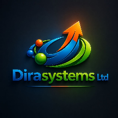
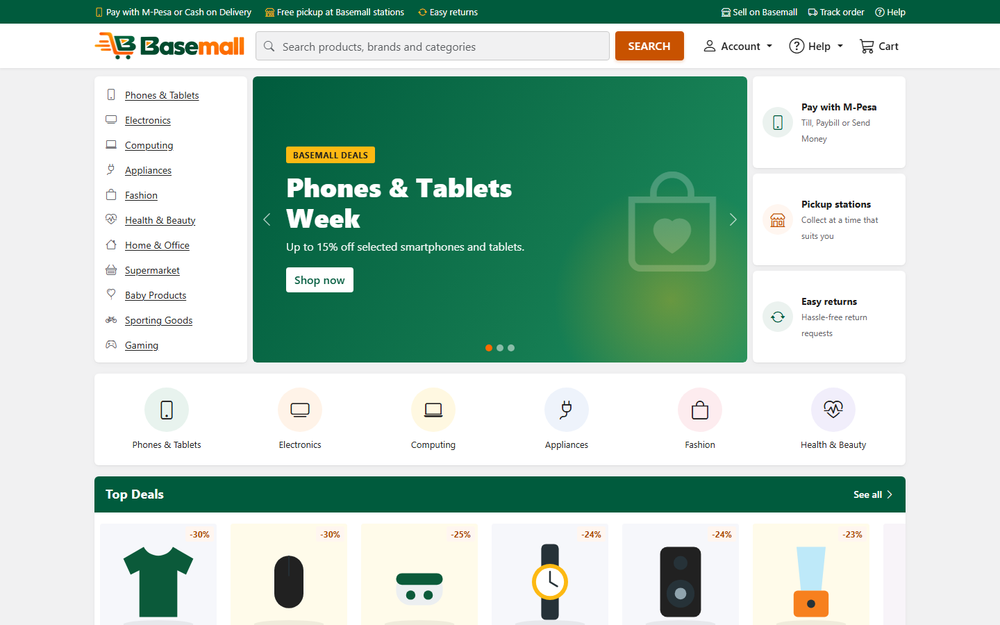

# Duncan Kinyua Gathogo

Software developer at **[Dira Systems Ltd](http://dirasystems.co.ke/)**: AI-driven ICT solutions from Nanyuki, Kenya.

I build web systems that hold up in real business: online shops and marketplaces, payments (M-Pesa), dashboards and back-office tools. I also work across Dira Systems' wider ICT services: networking, CCTV, cloud and automation for businesses, schools, NGOs and government.

🌐 [dirasystems.co.ke](http://dirasystems.co.ke/) · ✉️ [info@dirasystems.co.ke](mailto:info@dirasystems.co.ke) · 📍 Nanyuki, Laikipia County, Kenya

---

### Featured project: [Basemall](https://github.com/dirasystm/ecommerce)

A complete multi-vendor e-commerce marketplace for Kenya, built end to end:

- **Shopping:** cart and checkout with M-Pesa (Till, Paybill, Send Money) and cash on delivery; home delivery and pickup stations.
- **Sellers:** a Seller Centre with orders split per seller, commission, an append-only ledger and payouts.
- **Admin:** run without code, from branding, pages, menus and the homepage to payment methods and message templates.
- **Security:** role-based access with a permission matrix, two-step sign-in (TOTP) and tamper-proof audit logs.
- **Testing:** 473 automated tests, plus accessibility and mobile checks on every page.

### Tools I work with

PHP · MySQL / MariaDB · JavaScript · HTML & CSS · Bootstrap · PHPUnit · Git · Linux & Windows servers · networking & CCTV

---

💼 Open to software projects and roles, as an individual or through Dira Systems Ltd. [Get in touch](http://dirasystems.co.ke/).
